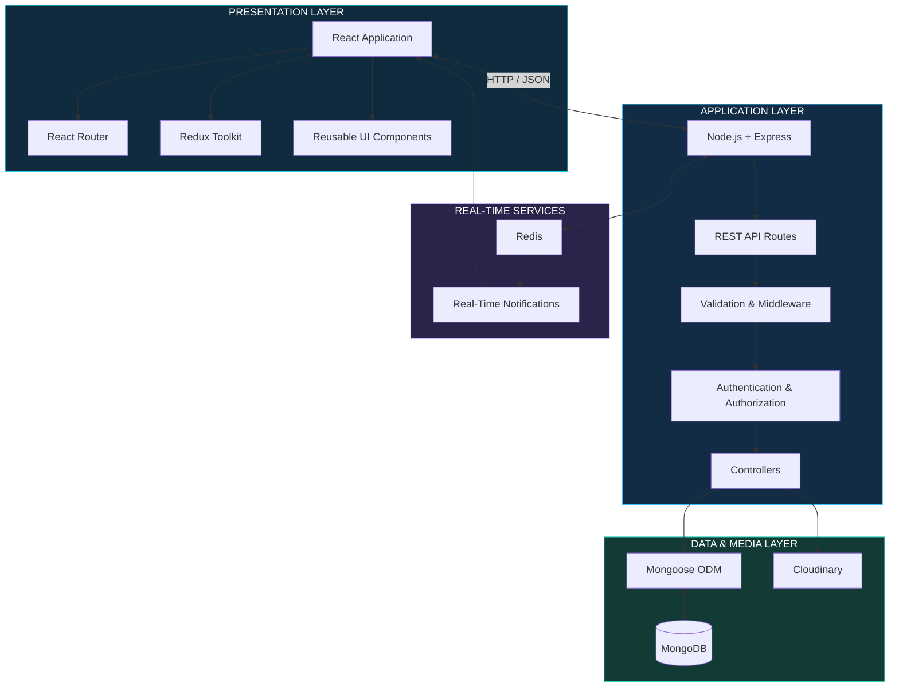
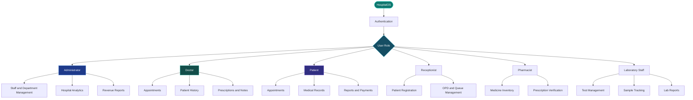
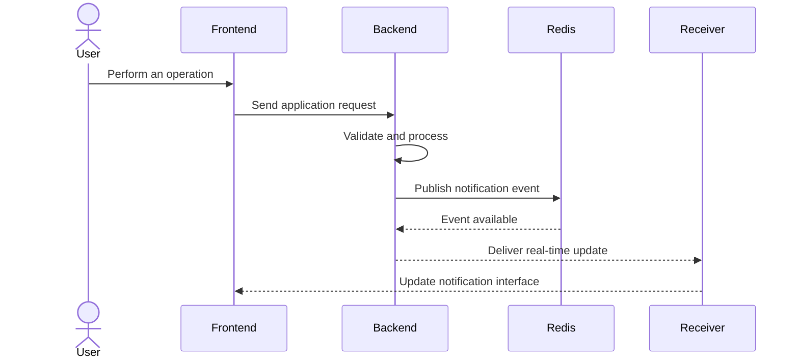
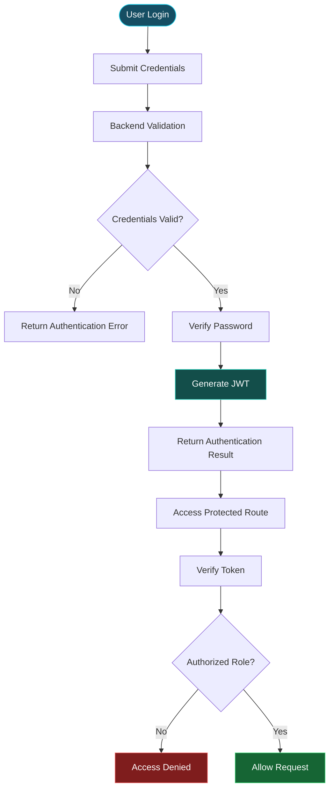
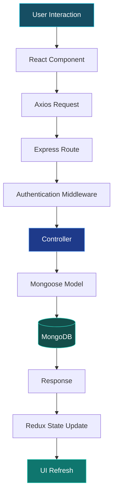

 <div align="center">

# 🏥 HospitalOS

### One Platform. Every Hospital Workflow.


<p>
  <strong>A full-stack hospital management platform connecting patients, doctors, administrators, and hospital departments through a unified digital workspace.</strong>
</p>

<p>
  <a href="https://github.com/Sarthaktanpure/HospitalOS">
    
  </a>
  <a href="https://hospital-os-black.vercel.app/">
    
  </a>
  
</p>

<p>
  
  
  
  
  
  
  
  
</p>

</div>

---

## `~/mission-control`

**HospitalOS** is a full-stack Hospital Management System (HMS) built to bring essential hospital operations into one connected platform.

Hospitals handle multiple workflows simultaneously: patient registration, appointment scheduling, consultations, prescriptions, laboratory reports, pharmacy inventory, billing, and administration.

When these workflows operate independently, information becomes fragmented and coordination becomes difficult.

HospitalOS addresses this challenge through a centralized application with dedicated interfaces and permissions for different hospital roles.

### The platform brings together

- **Clinical operations** — patient records, medical history, prescriptions and treatment notes.
- **Hospital administration** — staff, doctors, departments, permissions and analytics.
- **Patient services** — registration, appointments, medical records and reports.
- **Pharmacy operations** — medicine inventory, prescription verification and billing.
- **Laboratory workflows** — test bookings, sample tracking and report management.
- **Financial operations** — invoices, payments, receipts and revenue reporting.

<blockquote>
  <strong>Engineering objective:</strong> Build a unified healthcare operations platform where each role accesses the information and workflows relevant to its responsibilities.
</blockquote>

---

## `~/platform-at-a-glance`

<details>
<summary><strong>Explore the platform's functional modules</strong></summary>

| Module | Primary responsibility |
|---|---|
| Admin | Hospital configuration, staff, doctors, departments and analytics |
| Doctor | Appointments, medical history, prescriptions and treatment notes |
| Patient | Registration, appointments, medical records and reports |
| Reception | Patient registration, walk-in appointments and queue management |
| Pharmacy | Medicine inventory, stock management and prescription verification |
| Laboratory | Test booking, sample tracking and report uploads |
| Billing | Invoices, payment history and receipt management |
| Analytics | Revenue, patient activity, appointments and department performance |

</details>

---

## `~/architecture`

### 01. High-level system architecture

HospitalOS follows a separated frontend-backend architecture. The React application communicates with the Express API, which handles authentication, application logic, database operations and supporting services.



### 02. Role-based workflow architecture

Different hospital users need different interfaces and capabilities. HospitalOS organizes workflows around the responsibilities of each role.



### 03. Patient journey


---

## `~/feature-engineering`

### 01 — Doctor workspace

Designed around day-to-day clinical workflows.

- Doctor dashboard.
- Today's appointment overview.
- Patient medical history.
- Digital prescriptions.
- Treatment notes.
- Medical report uploads.
- Appointment scheduling.
- Emergency patient alerts.

### 02 — Administration workspace

Centralized management of hospital resources and personnel.

- Hospital dashboard.
- Doctor and staff management.
- Department management.
- User roles and permissions.
- Analytics dashboard.
- Revenue reports.
- Hospital settings.

### 03 — Patient portal

A dedicated space for patients to access their healthcare information.

- Online registration.
- Appointment booking.
- Medical record access.
- Prescription downloads.
- Laboratory report access.
- Payment history.
- Profile management.

### 04 — Pharmacy management

Digital medicine and prescription workflows.

- Medicine inventory.
- Stock management.
- Prescription verification.
- Medicine billing.
- Expiry tracking.

### 05 — Laboratory management

Organized laboratory operations.

- Test booking.
- Report uploads.
- Test history.
- Sample tracking.
- Report downloads.

### 06 — Reception and OPD

Front-desk workflows for patient intake and appointment coordination.

- Patient registration.
- Walk-in appointment booking.
- Queue management.
- OPD management.
- Patient search.

### 07 — Billing and finance

Financial workflows integrated with hospital operations.

- Invoice generation.
- Online payment workflows.
- Payment history.
- Insurance support.
- Receipt downloads.

### 08 — Appointment management

- Appointment booking.
- Rescheduling and cancellation.
- Calendar view.
- Doctor availability.

### 09 — Analytics and reporting

- Revenue statistics.
- Daily patient activity.
- Appointment trends.
- Department performance.
- Doctor performance.
- Occupancy reports.

---

## `~/real-time-operations`

Hospital workflows benefit from timely updates. HospitalOS incorporates Redis-backed real-time notification functionality to support communication between application components.

### Notification workflow



*The sequence illustrates the real-time notification concept; exact event names and transport implementation should be documented from the current source code.*

---

## `~/security`

Healthcare applications handle sensitive user and patient information. Access control and secure request handling are therefore important architectural concerns.

| Security layer | Implementation |
|---|---|
| Authentication | JWT-based authentication |
| Password security | bcrypt password hashing |
| Authorization | Role-based access control |
| Route protection | Protected application routes |
| Request validation | Input validation |
| Database protection | MongoDB injection protection |
| Web security | XSS protection |
| Media management | Cloudinary integration |

### Authentication lifecycle



---

## `~/technology-stack`

### Frontend engineering

| Technology | Role |
|---|---|
| React.js | Component-based frontend |
| Tailwind CSS | Responsive styling |
| React Router | Client-side navigation |
| Redux Toolkit | Application state management |
| Axios | HTTP communication |
| React Hook Form | Form handling |
| Framer Motion | UI animations |

### Backend engineering

| Technology | Role |
|---|---|
| Node.js | Server-side JavaScript runtime |
| Express.js | REST API framework |
| MongoDB | NoSQL database |
| Mongoose | Database modelling and queries |
| JWT | Authentication |
| bcrypt | Password hashing |
| Multer | File upload handling |
| Cloudinary | Cloud-based media management |
| Redis | Real-time notification support |

### Development tools

| Tool | Purpose |
|---|---|
| Vite | Frontend development and build tooling |
| Git | Version control |
| GitHub | Source code hosting |
| Postman | API testing |
| VS Code | Development environment |

---

## `~/data-flow`

A typical application request moves through the frontend, API layer, business logic and persistence layer.



---

## `~/repository-structure`

```text
HospitalOS/
│
├── ai-services/
│
├── backend/
│   ├── config/
│   ├── controllers/
│   ├── middleware/
│   ├── models/
│   ├── routes/
│   ├── uploads/
│   ├── utils/
│   └── server.js
│
├── frontend/
│   ├── public/
│   └── src/
│       ├── assets/
│       ├── components/
│       ├── pages/
│       ├── layouts/
│       ├── hooks/
│       ├── context/
│       ├── services/
│       ├── utils/
│       └── App.jsx
│
└── README.md
```

---

## `~/local-development`

### Prerequisites

- Node.js and npm.
- MongoDB connection string.
- Cloudinary account for media uploads.
- Git.

### 01 — Clone the repository

```bash
git clone https://github.com/Sarthaktanpure/HospitalOS.git

cd HospitalOS
```

### 02 — Configure the backend

```bash
cd backend
npm install
```

Create a `.env` file inside the backend directory:

```env
PORT=5000

MONGO_URI=your_mongodb_connection_string

JWT_SECRET=your_jwt_secret

CLOUDINARY_CLOUD_NAME=your_cloud_name
CLOUDINARY_API_KEY=your_api_key
CLOUDINARY_API_SECRET=your_api_secret
```

Start the backend:

```bash
npm run dev
```

### 03 — Configure the frontend

Open a second terminal:

```bash
cd frontend
npm install
npm run dev
```

### 04 — Open the application

```text
Frontend: http://localhost:5173
Backend:  http://localhost:5000
```

*The ports above are the documented local setup defaults. Check the actual Vite and backend configuration if your local environment uses different ports.*

---

## `~/environment-configuration`

| Variable | Description |
|---|---|
| `PORT` | Backend server port |
| `MONGO_URI` | MongoDB connection string |
| `JWT_SECRET` | JWT signing secret |
| `CLOUDINARY_CLOUD_NAME` | Cloudinary account name |
| `CLOUDINARY_API_KEY` | Cloudinary API key |
| `CLOUDINARY_API_SECRET` | Cloudinary API secret |

**Important:** Never commit `.env` files, database credentials, JWT secrets or Cloudinary credentials to GitHub.

---

## `~/engineering-decisions`

| Engineering decision | Why it matters |
|---|---|
| Separate frontend and backend | Keeps presentation and server responsibilities independent |
| Role-based access | Provides dedicated workflows for different hospital users |
| Redux Toolkit | Centralizes shared frontend application state |
| MongoDB and Mongoose | Provides flexible data modelling and persistence |
| JWT authentication | Supports authenticated API access |
| Cloudinary | Separates uploaded media from application code |
| Redis-backed notifications | Supports timely application updates |
| Modular feature organization | Makes individual hospital workflows easier to maintain |

### Why build a multi-module hospital platform?

A hospital management application is not just a patient registration form.

Its real complexity comes from connecting different operational areas while ensuring that each user sees the right information and can perform the right actions.

HospitalOS approaches this as an integrated application rather than a collection of disconnected CRUD screens.

---

## `~/future-engineering`

Potential directions for extending the platform:

- [ ] AI-assisted disease prediction.
- [ ] Medical chatbot.
- [ ] Telemedicine and video consultations.
- [ ] SMS and email notifications.
- [ ] QR-based patient identification.
- [ ] Hospital bed management.
- [ ] Ambulance tracking.
- [ ] Expanded electronic health record workflows.
- [ ] AI-assisted medical report summarization.
- [ ] Voice-based prescription entry.
- [ ] Face-recognition authentication.
- [ ] Enhanced accessibility and dark-mode support.

---

## `~/screenshots`

A strong project README should show the actual product—not just describe it.

Add real application screenshots in the following structure:

```text
docs/
└── screenshots/
    ├── login.png
    ├── admin-dashboard.png
    ├── doctor-dashboard.png
    ├── patient-portal.png
    ├── appointment-management.png
    ├── pharmacy-management.png
    ├── laboratory-dashboard.png
    └── analytics-dashboard.png
```

Suggested presentation:

| Screenshot | What it demonstrates |
|---|---|
| Admin Dashboard | Hospital overview and administration |
| Doctor Dashboard | Clinical workflow |
| Patient Portal | Patient-facing features |
| Appointment Management | Scheduling workflow |
| Pharmacy | Inventory and prescription handling |
| Analytics | Hospital activity and reporting |

---

## `~/project-impact`

HospitalOS brings several engineering disciplines together in a single application.

| Engineering area | Concepts demonstrated |
|---|---|
| Full-stack development | React, Node.js and Express |
| Database engineering | MongoDB and Mongoose |
| Authentication | JWT and bcrypt |
| Authorization | Role-based access control |
| State management | Redux Toolkit |
| Real-time systems | Redis-backed notifications |
| File management | Multer and Cloudinary |
| Application architecture | Modular frontend and backend |
| Healthcare workflows | Clinical, administrative and patient modules |

The central challenge is connecting these components into a consistent application where different hospital roles can collaborate through shared workflows and data.

---

## `~/contributing`

Contributions and suggestions are welcome.

1. Fork the repository.
2. Create a feature branch.
3. Implement and test your changes.
4. Commit your work.
5. Push the branch.
6. Open a pull request.

```bash
git checkout -b feature/your-feature

git add .

git commit -m "Add: your feature"

git push origin feature/your-feature
```

---

## `~/developer`

<div align="center">

### Sarthak Tanpure

**Software Engineering | Full-Stack Development | Applied AI**

Building practical software systems with an interest in scalable backend architecture, modern web applications, and intelligent technology.

<a href="https://github.com/Sarthaktanpure">
  
</a>

<a href="https://github.com/Sarthaktanpure/HospitalOS">
  
</a>

</div>

---

<div align="center">

### BUILT TO CONNECT. DESIGNED TO CARE.


<sub>One connected platform for modern hospital operations.</sub>

</div>
